# Diagrama de Estrutura de Diretórios

Este documento descreve a topologia de diretórios e arquivos do repositório `eijuito.github.io` em formato visual (Mermaid) e textual.

---

## 1. Diagrama Gráfico (Mermaid)

```mermaid
graph TD
    Root["📁 eijuito.github.io (Raiz)"]
    
    %% Configurações e Git
    Root --> Git[".gitignore"]
    Root --> NoJekyll[".nojekyll (Desativa Jekyll)"]
    Root --> Readme["README.md"]
    Root --> IndexRoot["index.html (Página Principal)"]
    Root --> Error404["404.html (Página de Erro)"]

    %% Workflows
    Root --> DotGithub["📁 .github/"]
    DotGithub --> Workflows["📁 workflows/"]
    Workflows --> DeployPages["deploy-pages.yml (CI/CD Pages)"]

    %% Docs
    Root --> Docs["📁 docs/"]
    Docs --> Plan["plano-projeto.md (Planejamento)"]
    Docs --> AiRules["ai-rules-and-skills.md (Regras para IAs)"]
    Docs --> StructDiagram["estrutura-diretorios.md (Este Diagrama)"]
    Docs --> DiagramsDir["📁 diagrams/ (Assets de diagramas)"]

    %% Assets
    Root --> Assets["📁 assets/"]
    Assets --> CSS["📁 css/ (main.css)"]
    Assets --> JS["📁 js/ (main.js)"]
    Assets --> Images["📁 images/"]

    %% Repo (Artefatos)
    Root --> Repo["📁 repo/ (Artefatos Públicos)"]
    Repo --> RepoIndex["index.html (Catálogo Geral de Repositórios)"]
    Repo --> RepoSub1["📁 &lt;nome-do-repositorio-privado-1&gt;/"]
    RepoSub1 --> RepoSub1Index["index.html (Guia de artefatos do repo)"]
    RepoSub1 --> RepoSub1Files["arquivos / releases / builds (.zip, .json, etc)"]
    Repo --> RepoSub2["📁 template-repo/"]
    RepoSub2 --> RepoSub2Index["index.html (Modelo padrão)"]
```



---

## 2. Árvore de Diretórios Textual

```text
eijuito.github.io/
├── .github/
│   └── workflows/
│       └── deploy-pages.yml              # Pipeline de deploy automático no GitHub Pages
├── assets/
│   ├── css/
│   │   └── main.css                      # Estilos compartilhados
│   ├── js/
│   │   └── main.js                       # Scripts interativos do site
│   └── images/                           # Imagens e logotipos
├── docs/
│   ├── ai-rules-and-skills.md            # Regras e habilidades para orientar IAs
│   ├── estrutura-diretorios.md           # Este diagrama e documentação de layout
│   ├── plano-projeto.md                  # Plano de implementação e boas práticas
│   └── diagrams/                         # Diagramas exportados e recursos visuais
├── repo/
│   ├── index.html                        # Portal/Índice de todos os repositórios públicos
│   └── template-repo/                    # Template base para novos repositórios privados
│       └── index.html                    # Orientações e downloads de artefatos do repositório
├── .gitignore                            # Arquivos ignorados pelo Git
├── .nojekyll                             # Desativa o processamento padrão do Jekyll
├── 404.html                              # Página de erro amigável
├── index.html                            # Landing page do usuário
└── README.md                             # Apresentação do repositório
```

