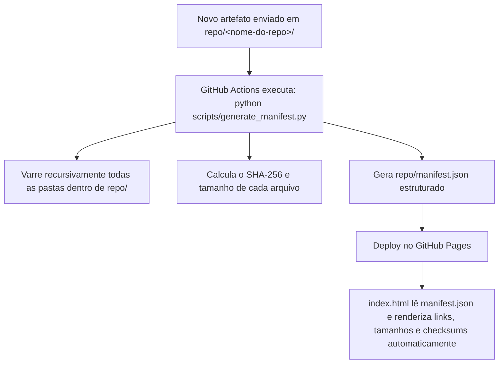

# Melhores Práticas para Repositórios de Artefatos Públicos

Este documento consolida os padrões da indústria (adotados por Apache, Debian, GitHub Releases e Homebrew) para gerenciamento, integridade e catálogo automático de artefatos em repositórios estáticos como o GitHub Pages.

---

## 1. Padronização de Nomes de Artefatos (Naming Conventions)

A nomenclatura previsível e semântica evita conflitos, facilita scripts de download automatizados (via `curl` ou `wget`) e torna o versionamento auditável.

### Padrão Recomendado (SemVer + Plataforma):
```text
<nome-do-projeto>_<versao>_<sistema-ou-plataforma>_<arquitetura>.<extensao>
```

### Exemplos Práticos por Domínio:
1. **Aplicações Enterprise / Java / JARs**:
   - `payment-gateway_v2.1.0_all.jar`
   - `financial-service_v1.4.2_dist.zip`
2. **Firmwares & Microcontroladores (IoT / ESP / Arduino)**:
   - `smart-switch_v1.0.3_esp32_qio-40mhz.bin`
   - `telemetry-node_v2.0.1_esp8266_flash4m.bin`
   - `sensor-hub_v1.2.0_arduino-nano_atmega328p.hex`
3. **MQL5 / Trading Automatizado**:
   - `scalper-engine_v3.2.0_mt5_x64.ex5`
   - `risk-manager_v1.0.1_mt5.mq5`

---

## 2. Garantia de Integridade e Verificadores (Checksum / SHA-256)

Para garantir que o arquivo baixado não sofreu corrupção na transmissão ou adulteração maliciosa, todo repositório profissional adota hashes criptográficos:

1. **Padrão Oficial: SHA-256**:
   - Para cada artefato, é gerado um hash SHA-256 de 64 caracteres hexadecimais.
   - Padrão Linux/GNU: manter um arquivo `SHA256SUMS` ou `checksums.txt` na pasta do repositório contendo:
     ```text
     e3b0c44298fc1c149afbf4c8996fb92427ae41e4649b934ca495991b7852b855  smart-switch_v1.0.3_esp32.bin
     a591a6d40bf420404a011733cfb7b190d62c65bf0bcda32b57b277d9ad9f146e  scalper-engine_v3.2.0_mt5.ex5
     ```
2. **Como o usuário valida localmente**:
   - No Linux/macOS: `sha256sum -c SHA256SUMS`
   - No Windows (PowerShell): `Get-FileHash .\smart-switch_v1.0.3_esp32.bin -Algorithm SHA256`

---

## 3. Políticas de Uso e Governança do Repositório (Repository Policies)

1. **Política de Imutabilidade de Versão**:
   - Uma vez publicado um artefato com tag de versão (ex: `v1.0.0`), ele **nunca deve ser sobrescrito**. Correções geram uma nova versão (`v1.0.1`).
2. **Sanitização de Segredos (Zero Leaks)**:
   - Nenhuma build ou firmware compilado para distribuição pública deve conter:
     - Wi-Fi SSIDs ou senhas hardcoded.
     - Tokens de bot (Telegram/Discord/APIs).
     - Chaves privadas, certificados `.pfx`/`.pem` ou credenciais de banco.
   - Variáveis sensíveis devem ser injetadas em tempo de execução via *runtime config*, *NVS (Non-Volatile Storage)* ou *EEPROM*.
3. **Política de Tamanho de Arquivo**:
   - Artefatos até **50 MB**: Podem residir diretamente na pasta `/repo/<projeto>/` do Git.
   - Artefatos entre **50 MB e 2 GB**: Devem ser anexados como *GitHub Releases Asset*, e o catálogo do site deve apenas apontar para o link direto de download do Release.

---

## 4. Detecção Automática de Pastas e Arquivos (Mecanismo Crawler)

Para eliminar a necessidade de criar e atualizar tabelas HTML manualmente a cada novo commit de artefato, a arquitetura moderna utiliza um **script gerador de manifesto (`manifest.json`) integrado ao GitHub Actions**.

### Arquitetura do Mecanismo:



### O que o JSON gerado contém:
```json
{
  "generated_at": "2026-11-03T23:00:00Z",
  "repositories": [
    {
      "name": "smart-switch-iot",
      "path": "repo/smart-switch-iot",
      "artifacts": [
        {
          "name": "smart-switch_v1.0.3_esp32.bin",
          "relative_url": "smart-switch-iot/smart-switch_v1.0.3_esp32.bin",
          "size_bytes": 1048576,
          "size_human": "1.00 MB",
          "sha256": "e3b0c44298fc1c149afbf4c8996fb92427ae41e4649b934ca495991b7852b855",
          "last_modified": "2026-11-03"
        }
      ]
    }
  ]
}
```

### Renderização Automática no Navegador:
A página `repo/index.html` faz um simples `fetch('manifest.json')` e cria tabelas responsivas com:
- Busca instantânea e filtros por projeto ou extensão (`.bin`, `.jar`, `.zip`, `.ex5`).
- Botão "Copiar SHA-256" ao lado de cada arquivo para validação rápida com um clique.
- Links diretos e tamanho formatado (`KB`, `MB`).

